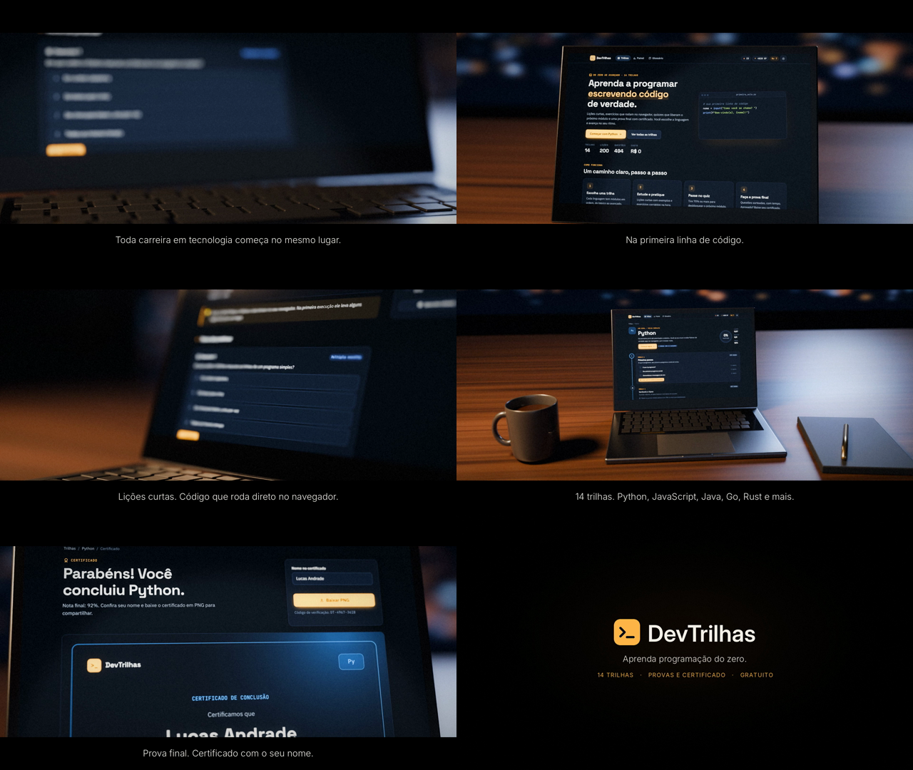

# Comercial DevTrilhas (34 s, 1080p, 24 fps)

**Vídeo:** [`DevTrilhas-comercial-30s.mp4`](DevTrilhas-comercial-30s.mp4), com 30 s de filme e 4 s de assinatura.

| Tempo | Plano | Letreiro |
|---|---|---|
| 0–4 s | Teclado em foco, tela da lição desfocada ao fundo | Toda carreira em tecnologia começa no mesmo lugar. |
| 4–9 s | Aproximação lenta da página inicial | Na primeira linha de código. |
| 9–14 s | Troca de foco do teclado para a lição | Lições curtas. Código que roda direto no navegador. |
| 14–19 s | Plano aberto em arco: mesa, caneca e cidade à noite | 14 trilhas. Python, JavaScript, Java, Go, Rust e mais. |
| 19–24 s | Aproximação do certificado | Prova final. Certificado com o seu nome. |
| 24–29 s | Afastamento e fade para o preto | Do zero ao avançado. No seu ritmo. |
| 29–34 s | Assinatura: logo, "Aprenda programação do zero." | |

Imagem 100% fotorrealista renderizada no Blender Cycles. Não há animação 2D nem personagens. As telas são capturas reais do site. A trilha sonora foi composta e mixada por código.

Para saber como foi feito e como fazer vídeos assim com IA, veja [COMO-FAZER-VIDEOS-DE-IA.md](COMO-FAZER-VIDEOS-DE-IA.md).
